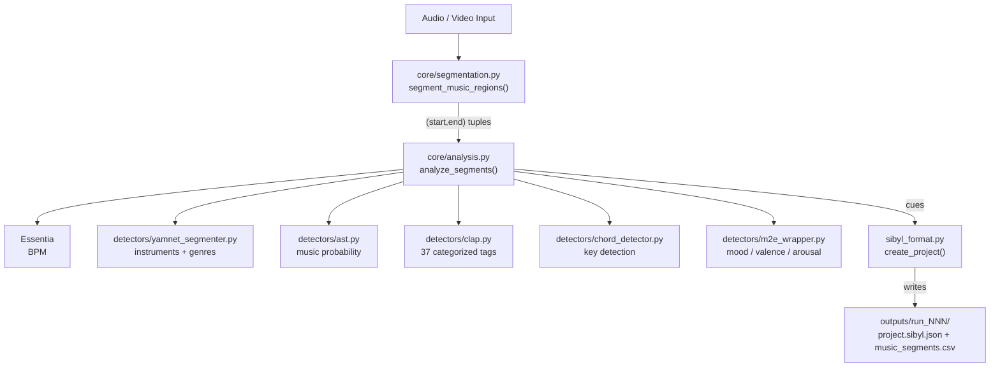

# SibyllAI Core

**Status: MVP backend complete. Web UI in active development.**

This repository contains the core engine for Motive-AI, an audio-spotting and music analysis tool designed to assist with film-music spotting, emotion mapping, and intelligent cue suggestions. The backend has been tested on production files (89-minute feature film MX).

---

## How It Works (High-Level Flow)

**Input → Analysis → Output**

1. **CLI Entry** - User provides video/audio file via command line
2. **Audio Extraction** - ffmpeg converts to mono 44.1kHz WAV
3. **Cue Detection** - YAMNet scans entire file to find where music starts/stops
4. **Per-Cue BPM** - Essentia analyzes tempo for each detected music segment
5. **Per-Cue Key** - Essentia extracts harmonic key information
6. **Per-Cue Instruments** - YAMNet detects individual instruments from 521 audio classes
7. **Per-Cue Genre/Style/Energy** - CLAP classifies across 37 categorized tags (genre, production, energy, era, orchestration)
8. **Per-Cue Mood** - Music2Emo analyzes valence, arousal, and emotional tags
9. **Output** - Generates `project.sibyl.json` with all cue data (musical_profile + project_context)

**Web UI flow**: Upload → Same backend pipeline → Display cues with waveforms + tags → Playback/editing

---

## Tech Stack
- **Python 3.11+**
- **PyTorch** (deep learning, model inference)
- **TensorFlow & Keras** (for YAMNet)
- **Librosa, SoundFile, Essentia** (audio processing)
- **YAMNet** (music cue segmentation + instrument/genre detection from 521 audio classes)
- **LAION-CLAP** (37 categorized tags: genre, production, energy, era, function, instrumentation)
- **Music2Emo** (mood/emotion: valence, arousal, mood tags)
- **Hydra** (configuration for Music2Emo)
- **FastAPI + Vite/React** (web UI)
- **Other ML/DS libraries:** scikit-learn, pandas, numpy, etc.

## Project Structure
```
src/sibyllai_core/
  cli.py                  # Command-line interface
  pipeline.py             # Legacy CLI pipeline (outdated)
  sibyl_format.py         # .sibyl.json project file builder
  detectors/
    yamnet_segmenter.py   # Cue segmentation + instrument/genre detection
    clap.py               # 37-tag CLAP analysis
    ast.py                # Music probability (AST model)
    m2e_wrapper.py        # Music2Emo mood wrapper
    chord_detector.py     # Key detection
  thirdparty/
    music2emo/            # Integrated Music2Emo package

sibyllai-web/
  backend/
    api/main.py           # FastAPI endpoints
    core/analysis.py      # Active analysis pipeline (no Demucs)
    core/segmentation.py  # YAMNet segmentation
  frontend/               # Vite/React web UI
```
- **examples/data/**: Example audio/video files for testing
- **outputs/**: Default output directory for CLI results

---

## Detailed Code-Level Flow

The active pipeline lives in `sibyllai-web/backend/core/analysis.py`. The root-level `pipeline.py` is a legacy CLI version that is not kept in sync.

1. **Segmentation** (`core/segmentation.py`)
   - ffmpeg extracts audio from video/audio input
   - YAMNet `segment_music_regions()` returns (start, end) tuples
   - Segments shorter than 3 seconds are skipped

2. **Per-segment analysis** (`core/analysis.py:analyze_segments()`)
   - **BPM** — Essentia `RhythmExtractor2013`
   - **Instruments** — YAMNet `extract_instruments()`, top 15 from 521 audio classes
   - **Genre** — YAMNet `extract_genres()`, top 10
   - **Music probability** — AST model
   - **Style/energy/era/function/instrumentation** — CLAP `tag_chunk()`, 37 categorized tags
   - **Key** — `chord_detector.analyze_chords()`
   - **Mood/valence/arousal** — Music2Emo `global_moods()` (run last; most fragile)

3. **Output** (`sibyl_format.py`)
   - `create_cue()` builds per-cue data with `musical_profile` + `project_context`
   - `save_project()` writes `project.sibyl.json`
   - Backwards-compatible `music_segments.csv` also written

---

## Visual Flowchart (Mermaid)



---

## ⚠️ Security Notice: PyTorch Version

This project currently pins `torch==2.2.2` due to compatibility requirements with other dependencies.

- **Known vulnerability:** Remote Code Execution (RCE) via `torch.load` with `weights_only=True` (CVE-2025-32434).
- **Mitigation:**
  - **Do NOT load untrusted model files** using `torch.load`.
  - Avoid using `weights_only=True` with files from untrusted sources.
  - Only use model files you have created or that come from trusted sources.

We will upgrade to a patched version as soon as compatibility allows.
See [GitHub security advisory](https://github.com/pytorch/pytorch/security/advisories/GHSA-53qg-r3pm-6pq6) for more details.
